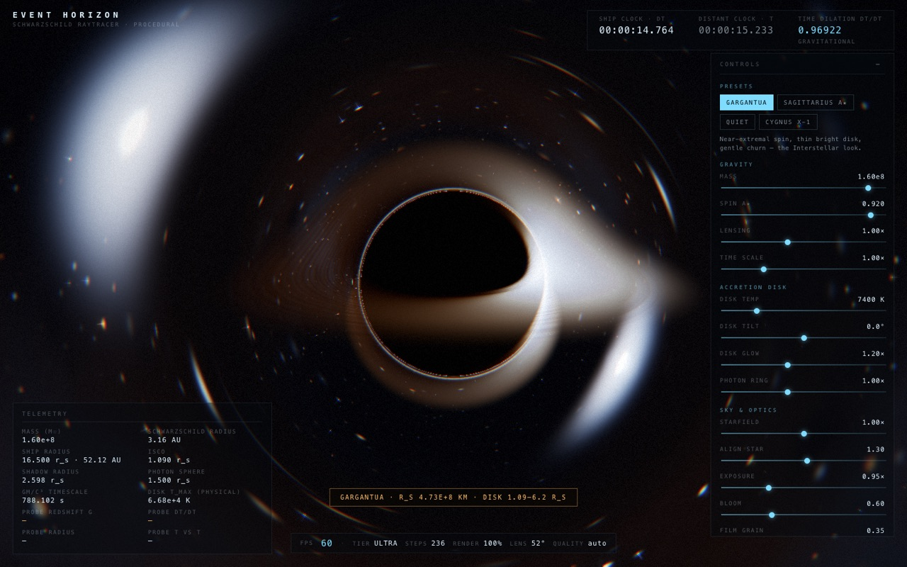
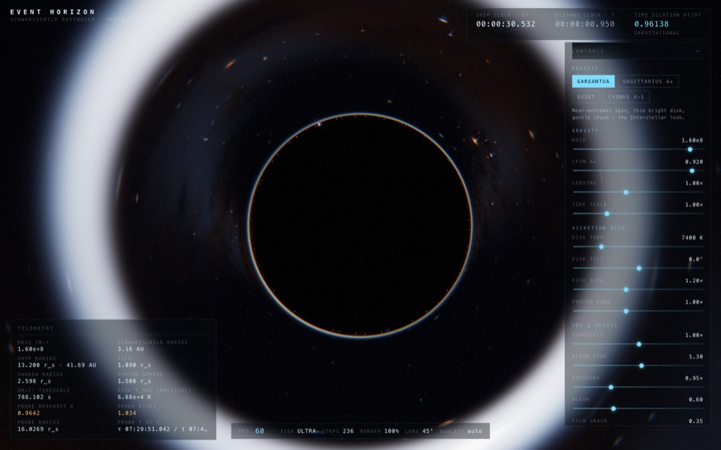

# Event Horizon

An interactive, real-time black hole simulator that raymarches **null geodesics** around a
Schwarzschild black hole on the GPU. Everything is procedural — no textures, no models, no
HDRIs, no network requests. One quad, one fragment shader, plus a small post chain.

> ### Built by a local LLM
> This entire project — physics module, GLSL geodesic integrator, renderer, HUD, tests, tooling and
> documentation — was written by a **local language model**, [`Qwen3.8-Flash-Next-GGUF`](./PROMPT.md)
> (quantized, served locally through Unsloth Studio) running at **high reasoning effort** inside the
> `pi` coding agent. No cloud API, no human-written code.
>
> **Time to build: ≈ 1 h 18 m of wall-clock agent time** (~54 min from the brief to a tested, built,
> browser-verified simulator; the remaining ~24 min went into numerical validation, two extra test
> suites and docs). Roughly a third of that is machine time — booting headless WebGL2 contexts and
> reading back 1440×900 float framebuffers for the render assertions. See [`PROMPT.md`](./PROMPT.md)
> for the original brief, run metadata and the time breakdown.

**▶ Live demo: <https://whobutsb.github.io/event-horizon/>** — everything runs in your browser; no
install, no assets, no account. Pushing to `main` redeploys it (`.github/workflows/pages.yml`).


*Gargantua — near-side band across the shadow, the far side of the disk arced above and below it,
Doppler-bright limb on the right, photon ring, lensed starfield.*


*The "align star" slider parks a background star directly behind the hole; its light wraps into a
complete Einstein ring.*

```
npm install
npm run dev          # http://localhost:5173
```

Requires a **WebGL2** browser (Chrome, Edge, Brave, Safari 15+, Firefox). Runs at 60 fps on a
desktop GPU; the quality governor drops resolution/step count automatically if it cannot.

```
npm run build        # production bundle into dist/
npm run preview      # serve the production build on :4173
npm run test         # unit tests + (if Chrome is available) the browser render test
npm run test:unit    # fast, headless physics/presets/camera/quality tests
npm run verify       # unit tests -> production build -> real-browser render assertions
npm run render:check # standalone GPU smoke test: screenshots + metrics into .artifacts/
npm run probe:webgl  # print the GL renderer/capabilities a headless browser exposes
npm run deploy       # create/publish the GitHub repo and deploy to Pages (needs `gh auth login`)
npm run check:live   # load the deployed URL in headless Chrome and assert it renders at 60 fps
```

---

## What you are looking at

| Effect | Where it comes from |
| --- | --- |
| The black silhouette | rays whose geodesic ends on the horizon |
| The far side of the disk arcing **above and below** the shadow | light bending: `d²u/dφ² + u = 3/2 · r_s · u²` |
| One limb white-hot, the other dim and orange | relativistic Doppler beaming, `I ∝ g³` |
| Thin bright ring hugging the shadow | photon ring (rays that orbited near `r = 1.5 r_s`) |
| Starfield smeared into arcs, a perfect ring when a star hides behind the hole | the same geodesic integration, applied to the sky |
| Stars stretching into radial streaks as you dive | finite light-travel-time across the wavefront (post pass) |
| A probe that reddens, stretches and freezes at the horizon | `dr/dt = (1 - r_s/r)·dr/dτ → 0`, `g → 0` |

### Controls

| Input | Action |
| --- | --- |
| drag | orbit around the hole |
| wheel / pinch | zoom |
| `W`/`S`, shift-drag, right-drag | fly in / out (crossing the horizon is allowed) |
| `A`/`D`, arrows | orbit |
| `P` | drop a probe |
| `C` | cinematic (scripted, loopable camera for recording); `C`, `Esc` or the on-screen pill exits |
| `H` | hide the HUD |
| `R` | reset to the current preset |
| `1`–`4` | Gargantua / Sagittarius A★ / Quiet / Cygnus X-1 |

Cinematic mode fades the chrome out for clean recording, and leaves a single clickable
`REC — click or press C / Esc to exit` pill on screen (the panel's own button is deliberately invisible
at that point, which is exactly how "I can't leave cinematic mode" happens if you forget it).

The right-hand panel exposes mass, spin `a★`, lensing strength, time scale, disk temperature,
disk tilt, disk glow, photon-ring strength, starfield density, an "align star" slider (drive a
background star behind the hole and watch the Einstein ring close), exposure, bloom and film grain.

The HUD reports live: ship clock vs. distant clock, `dτ/dt`, mass in solar masses, Schwarzschild
radius in AU/km or ly, ship radius, shadow radius, photon sphere, ISCO, `GM/c³` timescale, probe
redshift `g`, probe `dτ/dt`, probe radius, probe proper time vs. coordinate time, fps, quality tier,
step count, render scale and the current lens angle.

---

## Units

Two unit systems, deliberately:

* **Renderer**: geometric units with `r_s = 1` (`r_s = 2GM/c²`). Time is `r_s/c`, so one unit of
  sim time is the light-crossing time of the horizon — `788 s` for a `1.6e8 M☉` hole.
* **HUD/`src/physics.js`**: SI (`G`, `c`, `M☉`, AU, ly) so the readouts are real numbers for real
  objects. `presets.js` maps slider values to both.

---

## The physics, effect by effect

### 1. Light bending (the raymarcher)

For null geodesics in the Schwarzschild metric, the orbit equation in `u = 1/r` is

```
d²u/dφ² + u = 3/2 · r_s · u²
```

Because `h = |x × v|` is conserved, this 2-D orbit equation can be lifted into 3-D as a particle
equation with an effective central force (this is exact for null rays — the "Newton-with-light"
trick used by most real-time black hole renderers):

```
ẍ = -(3/2) · h² · x / |x|⁵
```

`src/shaders/blackHole.js` integrates that backwards from the camera with **velocity-Verlet**, using
`h² = |x₀ × v₀|²` fixed at the camera. Step size is `dt ≈ 0.085·r/|v|` clamped to `[0.0035, 1.9]`:
fine where spacetime is curved, coarse in flat space. A ray stops when it crosses `r = 1` (captured →
black), when it passes `r = 46` moving outward (escaped → sample the sky), or when the step budget runs out.

Consequences that fall out for free, with no fudge factors:

* The **shadow** has apparent radius `b_crit = 3√3 M = 2.598 r_s`, i.e. 1.5× the horizon.
* The **photon sphere** at `1.5 r_s` traps near-tangential rays into multiple images of the disk,
  which is what produces the Interstellar-style arc over the top and the second arc underneath.
* Rays that clip the photon sphere wrap 1–3 times, producing the thin **photon ring**.

The integrator was validated outside WebGL: a JS replica of the exact shader loop reproduces the
analytic escape cone `sin ψ = (3√3/2)(r_s/r)√(1 - r_s/r)` to well under a degree at every radius,
and matches a 60× finer reference integration to ~0.2°. See *Tests* below.

### 2. The accretion disk

A thin equatorial disk between the ISCO and `13.5 r_s`. On each plane crossing the shader takes the
intersection point and accumulates emission along an estimated path length (longer for grazing rays,
capped so near-tangent views do not turn into fog), then attenuates by an exponential optical depth —
so multiple lensed images of the same annulus all appear, correctly stacked.

* **Inner edge** = prograde Kerr ISCO from the Bardeen–Press–Teukolsky formula
  (`a★ = 0 → 3 r_s`, `a★ → 1 → 0.5 r_s`), never inside the horizon radius `(1 + √(1-a★²))/2 · r_s`.
* **Rotation** = Keplerian, `Ω(r) = √(0.5)·r^{-3/2}` in `r_s/c` units, so the inner disk visibly
  shears faster than the outer disk; turbulence is advected with it.
* **Temperature** = Shakura–Sunyaev profile, normalised to peak at 1:

  ```
  T(r) = T_max · u^{-3/4} (1 - u^{-1/2})^{1/4} / max(…),   u = r / r_in
  ```

  peaking at `u = 9/7`. Colour comes from a Planckian (blackbody) approximation of that temperature,
  so the inner rim is blue-white and the outer disk orange.
* **Turbulence** = value-noise fbm in `(log r, φ - Ωt, z)` with filamentary and granular terms; density
  drives both emission and opacity.
* The HUD also shows the **physical** effective temperature of a steady thin disk at 10 % Eddington,
  `T_max = 0.488·(3GMṁ / 8πσ r_in³)^{1/4}` — which scales as `M^{-1/4}`, i.e. supermassive holes radiate
  in the UV and stellar-mass holes in X-rays. The on-screen colour is the *slider*, because we render a
  narrow optical band, not a physical spectrum.

### 3. Relativistic Doppler beaming

Each crossing computes the circular-orbit speed seen by a local static observer,

```
β = √( (r_s/2) / (r - r_s) )        (= c at the photon sphere, 0.5 c at the ISCO)
```

and the Doppler factor for velocity direction `μ = cos(angle to observer)`:

```
g_D = 1 / (γ (1 - β μ)),     γ = 1/√(1-β²)
```

multiplied by the gravitational redshift from the emission radius to the camera,
`g_G = √(1 - r_s/r) / √(1 - r_s/r_cam)`. Then:

* observed specific intensity `∝ g³` (invariance of `I_ν/ν³`) — the approaching limb is ~5–20× brighter;
* the spectrum shifts by `g`, so the same blackbody is evaluated at `T·g`: the approaching side turns
  blue-white, the receding side deep orange.

This is why one side of the disk is dramatically brighter *and* bluer, and why it stays that way under
lensing — the factor is attached to the emitting material, not to screen position.

### 4. Gravitational time dilation and redshift

Static clock: `dτ/dt = √(1 - r_s/r)`. The HUD's "ship clock vs distant clock" runs at that rate, so
near the horizon your local seconds visibly stretch relative to the outside universe (the disk animation
and star drift slow down in the same ratio — they are driven by `simT`, which is integrated with `dτ`).

### 5. The probe

`P` (or the button — which stays actionable, so you can drop as many as you like; the running probe's
status is reported in telemetry) deploys a probe **ahead of the ship** — about half the ship's radius
out, tilted ~6° off the ship→hole axis, mostly screen-vertical — and releases it from rest. That
geometry is deliberate: releasing it at your own radius puts it *beside* the camera, at almost zero
depth, so it lands outside the field of view and looks like nothing happened. It then integrates the
**radial timelike geodesic** in coordinate time `t` with RK4 (`src/probe.js`, math in `src/physics.js`):

```
E      = √(1 - r_s/r₀)                                  specific energy
dr/dτ  = -√( E² - 1 + r_s/r )                           infall speed, → -c at the horizon
dt/dτ  = E / (1 - r_s/r)                                → ∞ at the horizon
dr/dt  = (1 - r_s/r) · dr/dτ                            → 0 at the horizon
g      = (1 - r_s/r) / ( E + √(E² - 1 + r_s/r) )        observed redshift, → 0
```

Because the integration is in `t`, the **freeze is not scripted**: the probe's coordinate speed simply
goes to zero while its own clock (`τ`) keeps marching through the horizon. Its colour is a blackbody at
`6500 K · g` and its brightness falls like `g^1.15`, while the tidal term elongates it radially —
spaghettification, visible as stretching before it fades to infrared and vanishes.

Drawing it is subtler than it looks: geodesic steps are ~0.6 r_s long out there, far coarser than the
probe itself, so sampling an emissive ball at step centres lights it only by luck (it looked like a bug:
"nothing appears"). Each ray segment therefore tests its **closest approach** to the probe and
accumulates from that — brightness independent of the step budget, and every geodesic branch still
produces its own lensed image. A short bright flare on release helps the eye find it.

### 6. Stars, galaxy band, Einstein ring

The sky is sampled **at the end of each geodesic**, using the ray's final direction, so lensing of the
starfield uses exactly the same integration as the disk — no separate "lensed sky" hack. Hash-based
cellular stars (three parallax layers), a faint fbm galaxy band with dust lanes, and a draggable
background star. When that star passes behind the hole its light is wrapped into a complete **Einstein
ring**; the render test drives the alignment slider and asserts the ring lights the scene up ≥2.5×.

### 7. Near the horizon: the lens opens and pans

Inside ~`2.7 r_s` the shadow is physically wider than a normal field of view — every ray in front of you
ends on the horizon, so a 50° lens renders a *completely black* frame (verified: this is correct, not a bug).
Two automatic behaviours keep it legible and honest (`src/camera.js`):

* `fovWidenFactor()` opens the lens up to 124° as you approach (dolly-zoom style), and
* `lookAwayAngle()` pans the view up to 52° sideways, because inside the photon sphere the surviving
  escape cone is a region around "outwards", not in front of you.

The HUD strip shows `LENS 124° wide pan` when either is active. A unit test sweeps every flyable radius
and asserts some sky always survives in the frame.

### 8. Post chain (`src/shaders/post.js`)

HDR float target → bright pass → separable blur pyramid (bloom) → composite with filmic **ACES** tonemap,
radial **star stretching** anchored to the shadow's screen position (light-travel-time streaks), mild
chromatic aberration, vignette, and **film grain + dither** (the dither also kills 10-bit banding in the
dark sky). Grain/dither are seeded per frame so video shows real film noise.

### 9. Automatic quality scaling

`QualityGovernor` (`src/scene.js`) tracks an EMA of frame time with hysteresis: below **50 fps** it drops
a tier, above **58 fps** for a sustained window it climbs back, with cooldowns so it cannot oscillate.
Tiers ULTRA → HIGH → MEDIUM → LOW → MINIMAL scale render resolution (1.0 → 0.42), geodesic step count
(236 → 72) and bloom levels. Manual override in the panel; NaN/glitched frame times are ignored.

---

## Layout

```
index.html                 shell, canvas, HUD containers, inline procedural favicon
src/main.js                wiring: clocks, resize, frame loop, keyboard, telemetry
src/scene.js               renderer, HDR targets, render graph, uniform sync, QualityGovernor
src/camera.js              orbit/fly rig, cinematic keyframe path, auto lens + pan, shadow screen pose
src/physics.js             all the maths (SI + geometric), probe ODE, formatters  ← unit tested
src/presets.js             parameter spec, clamping, presets, slider mapping       ← unit tested
src/probe.js               probe state, RK4 infall, redshift colour/stretch
src/ui.js                  HUD + control panel built in the DOM, readouts, toasts
src/shaders/common.js      hashing, value noise, fbm, blackbody, disk profile (GLSL port)
src/shaders/blackHole.js   geodesic raymarcher: disk, beaming, sky, photon ring, probe
src/shaders/post.js        bright pass, blur, composite/ACES/streak/grain
scripts/browser.mjs        locate a Chromium-family browser for the headless checks
scripts/render-check.mjs   GPU smoke test: boots the build, drives it, reads pixels back
tests/*.test.js            vitest suites (physics, presets, camera+quality, browser render)
```

## Sharing it (GitHub Pages)

The app is reachable at `https://<user>.github.io/<repo>/`. The build uses relative asset URLs
(`base: './'`), which is what makes that sub-path work — no configuration needed for a fork (verified:
the production bundle renders at 60 fps from a `/event-horizon/` sub-path with zero console errors).

`npm run deploy` (`scripts/deploy-gh.sh`) does the whole publishing flow with `gh`: creates the public
repo if missing, pushes `main`, runs `npm run build`, force-publishes `dist/` (+ `.nojekyll`) to the
`gh-pages` branch, points Pages at that branch and polls until the site actually serves the page.
`npm run check:live` then loads the deployed URL in headless Chrome and asserts on real pixels — same
bar as the local tests (currently: 60 fps at ULTRA, black shadow, no console or asset errors). It
needs only the `repo` OAuth scope — no Actions, no secrets, idempotent. `GH_OWNER` / `REPO_NAME`
override where it goes.

Prefer CI deploys? Copy `docs/github-pages-workflow.yml` to `.github/workflows/pages.yml` and flip
Pages to "GitHub Actions" — pushing a workflow path just requires a token with the `workflow` scope.

## Tests

```
npm run test:unit    # 114 assertions, no GPU needed
npm run verify       # + production build + real browser, reading the actual framebuffer
```

`tests/physics.test.js` — Schwarzschild/gravitational radii, `dτ/dt`, redshift vs. analytic values,
Doppler factor limits (approaching/transverse/receding), `g³` beaming, orbital speed reaching `c` at the
photon sphere, Kerr ISCO + horizon consistency (`r_isco > r_+` for every spin), the Shakura–Sunyaev
profile's peak location and normalisation, probe infall (freezing `dr/dt → 0`, `g → 0`, monotone `τ`),
formatters.

`tests/presets.test.js` — every slider in the spec is finite/clamped/monotone, presets round-trip through
slider positions and back, derived values (`diskInner ≥ horizon`, ISCO from spin) stay physical, hostile
input (`NaN`, strings, out of range) cannot corrupt state.

`tests/quality.test.js` — the quality ladder degrades under 30 fps, recovers at 120 fps, never oscillates
at a steady rate, respects manual locks, survives NaN timing; the camera rig cannot cross the horizon or
escape to infinity, cinematic keyframes loop seamlessly and dive close then pull out; the auto-lens/pan
keep sky in frame at every radius.

`tests/render.browser.test.js` — skips itself without a browser. Otherwise it serves `dist/`, launches
headless Chromium with WebGL2 (Metal via ANGLE), and asserts on real pixels: programs compiled, fps > 25,
shadow centre black (< 0.05 luma), an annulus peak ≥3× the far field (lensing), lensing-on vs -off frame
difference, all four presets clicked with differing results, probe fall + reddening + stretch measured
through the DOM buttons, cinematic lock/unlock, `dτ/dt < 0.45` at `1.08 r_s`, sky still visible near the
horizon, Einstein ring ≥2.5× brighter than the same sky unaligned, and the governor dropping a tier under
simulated load.

## Approximations (deliberate, and where they bite)

* **Spin is cosmetic-adjacent**: `a★` moves the ISCO, horizon radius, inner-disk temperature and colour,
  but light bending stays Schwarzschild — no frame dragging, so the two limbs are not asymmetric in
  *shape*, only in brightness. Full Kerr ray tracing needs a different integrator (Carter constants).
* **Thin, smooth disk**, one crossing per plane segment with an estimated path length; no radiative
  transfer, no vertical structure, no self-gravity, no spectral line broadening.
* **Sky is procedural** and static in the rotating frame; there is no cosmological redshift or CMB.
* The geodesic integrator is first-order-accurate per step but validated against the analytic cone;
  very near-critical rays can be captured a hair early, which slightly sharpens the photon ring.
* Bloom/grain/exposure are cinematic choices, not photometry.

## Troubleshooting

* **"WebGL2 not supported"** — enable hardware acceleration, or try another Chromium build. Run
  `npm run probe:webgl` to print the unmasked GL renderer plus the capabilities the raymarcher needs
  (float/half-float colour buffers, uniform and varying budgets). On headless Linux the checks pass
  `--use-gl=angle` / SwiftShader fallbacks (`scripts/browser.mjs`).
* **Render test says "no Chromium-family browser found"** — set `EH_BROWSER=/path/to/chrome`, or skip with
  `EH_SKIP_BROWSER=1 npm test`.
* **Slow start** — the first frames compile shader programs and (at ULTRA) march 236 steps per pixel; the
  governor settles within a second.
* **Everything black when you fly in** — that is real: see §7. Pull back above ~`3 r_s`, or keep flying:
  the lens widens and pans to keep the universe in shot.
